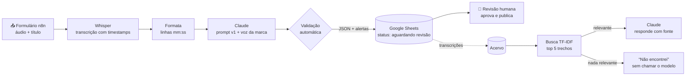

# 🎙️ Às Sábias Reflexões — IA de episódio a conteúdo

> Automação com IA que transforma o áudio de um episódio de podcast em show notes, capítulos, cortes para Reels, posts e newsletter — e um agente que responde perguntas sobre todo o acervo citando episódio e minuto.

**Autora:** Luiza Miller · Product Owner do Às Sábias Reflexões (dez/2024–ago/2025)
**Stack:** n8n · Claude API · OpenAI Whisper · Google Sheets · Python · Streamlit

---

## 1. O problema

Como Product Owner do podcast, acompanhei de perto o que acontecia depois de cada gravação. O episódio pronto era só o começo: alguém precisava ouvir tudo de novo para escrever a descrição, marcar os capítulos, achar os melhores trechos para Reels, escrever posts para cada rede e montar a newsletter.

Era trabalho manual, repetitivo e sempre feito com pressa — e o acervo de episódios antigos, cheio de conteúdo bom, ficava esquecido porque ninguém lembrava *em qual episódio* algo tinha sido dito.

## 2. A solução

O projeto tem duas partes independentes:

| | Parte 1 — Episódio → Conteúdo | Parte 2 — Pergunte ao acervo |
|---|---|---|
| **O que faz** | Recebe o áudio e entrega 8 peças de conteúdo prontas para revisão | Responde perguntas sobre episódios antigos com citação de episódio e minuto |
| **Quem usa** | Equipe de conteúdo | Equipe (pauta, cortes antigos) e, futuramente, ouvintes |
| **Ferramentas** | n8n, Whisper, Claude, Google Sheets | Python, TF-IDF, Claude, Streamlit |
| **Pasta** | [`workflows/`](workflows/) e [`prompts/`](prompts/) | [`agente-acervo/`](agente-acervo/) |

### Arquitetura



### O que sai de cada episódio (uma linha na planilha)

Resumo curto · Show notes · Capítulos com horário · 3–5 cortes para Reels (início, fim, gancho e por que funciona) · Citações literais · Post para Instagram · Post para LinkedIn · Newsletter (assunto + corpo) · **Alertas de revisão** · Tempo de processamento · Tokens usados · Versão do prompt

## 3. Decisões de produto e de prompt

Estas escolhas foram o centro do projeto — a parte técnica é simples de propósito.

**Humano no circuito, sempre.** Nada é publicado automaticamente. Toda linha entra na planilha como *"Aguardando revisão"*. Um podcast fala em nome de pessoas reais; o custo de uma frase inventada é muito maior que o tempo economizado.

**Validação automática contra alucinação.** Depois que o Claude responde, um nó de código confere:
- se a resposta é um JSON válido com todos os campos;
- se cada **citação existe literalmente** na transcrição;
- se cada **corte** tem horário válido, dentro da duração do episódio e com duração razoável.

O que falhar não trava o fluxo: vira um ⚠️ na coluna *Alertas de revisão*, para o revisor olhar primeiro.

**O modelo tem permissão para dizer que não sabe.** O campo `alertas_revisao` no esquema dá ao Claude um lugar honesto para registrar trechos confusos da transcrição, em vez de "chutar". No agente do acervo, se a busca não encontra nada relevante, a resposta é *"não encontrei"* — e o modelo nem é chamado (zero custo, zero chance de inventar).

**Timestamps prontos na entrada.** O Whisper devolve segundos; o workflow converte para `[mm:ss]` antes de enviar. O modelo só precisa *copiar* horários que já existem, em vez de calcular — o que reduz cortes com horários inexistentes.

**Voz da marca separada da lógica.** O tom do podcast fica em [`config/voz-da-marca.md`](config/voz-da-marca.md). A equipe ajusta o estilo sem mexer nas regras do prompt.

**Prompts versionados.** Cada versão fica em [`prompts/`](prompts/), com o motivo da mudança em [`CHANGELOG.md`](prompts/CHANGELOG.md). A versão usada é gravada em cada linha da planilha, para comparar resultados entre versões.

## 4. Resultados

> ⏳ **Em medição.** Os números abaixo serão preenchidos com episódios reais — veja o método em [`docs/metricas.md`](docs/metricas.md).

| Métrica | Antes (manual) | Depois (com IA) |
|---|---|---|
| Tempo da equipe por episódio | _a medir_ | _a medir_ |
| Tempo de processamento automático | — | _a medir_ |
| % de peças aprovadas sem edição | — | _a medir_ |
| Custo de API por episódio | — | _a medir_ |

### Qualidade da busca do acervo

Medida com [`agente-acervo/avaliar.py`](agente-acervo/avaliar.py): para cada pergunta de um gabarito, a busca acerta se um dos 3 primeiros trechos contém a resposta, ou se não devolve nada quando o assunto não está no acervo.

| Versão | O que mudou | Gabarito de exemplo (9 perguntas) | 1 episódio real (11 perguntas) |
|---|---|---|---|
| v1 | Palavras inteiras, trechos de 6 falas | 78% | 73% |
| v2 | Pedaços de palavras, trechos de 3 falas, limiar 0,12 | **89%** | **82%** |

**Por que mudou:** no teste com um episódio real, a v1 não achava "culpa por gastar dinheiro com algo caro", porque na fala as palavras aparecem de outro jeito ("culpada", "caro demais"). Comparar pedaços de palavras e usar trechos menores resolveu boa parte desses casos.

**O que ainda erra:** perguntas cujo assunto aparece só por exemplos ("elogio", quando a fala é "que roupa linda"). Para isso existe a reescrita da pergunta pelo Claude (`REESCREVER_PERGUNTA=1`), ainda a medir.

## 5. Como rodar

Guia completo em [`docs/como-instalar.md`](docs/como-instalar.md). Resumo:

**Parte 1 (n8n):** importe `workflows/episodio-para-conteudo.json` no n8n, conecte as credenciais da OpenAI, Anthropic e Google Sheets, cole a URL da planilha e abra o link do formulário.

**Parte 2 (agente):**
```bash
cd agente-acervo
pip install -r requirements.txt
export ANTHROPIC_API_KEY="sua-chave"
pytest -q                 # testes rodam sem chave de API
python avaliar.py         # mede a qualidade da busca (use --versao v1 para comparar)
streamlit run app.py      # interface de chat
```

As transcrições em `agente-acervo/dados/transcricoes/` são **exemplos fictícios** para testes. Para usar com o acervo real, coloque os `.txt` dos episódios no mesmo formato.

## 6. Limitações e próximos passos

- **Áudio acima de 25 MB** precisa ser comprimido ou dividido (limite da API de transcrição). Próximo passo: dividir automaticamente no próprio fluxo.
- **A busca (TF-IDF) não entende significado**: "ansiedade" não encontra "nervosismo". A v2 reduziu o problema com variações de palavras, e a reescrita da pergunta pelo Claude ajuda nos demais casos. Próximo passo, se não bastar: embeddings, que buscam por significado.
- **Perguntas fora do tema às vezes passam pela busca** (ex.: "melhor time de futebol"). As notas dessas perguntas se misturam com as de perguntas válidas, então nenhum limiar separa as duas. A rede de segurança é o próprio Claude, instruído a responder que o acervo não trata do assunto; o custo é uma chamada desnecessária.
- **Identificação de quem fala** (diarização) ainda não existe; as citações não dizem se foi o apresentador ou o convidado.
- **Publicação**: depois da aprovação na planilha, um segundo fluxo poderia agendar os posts automaticamente.

## 7. O que aprendi
**Do lado de produto.** Como PO do podcast, eu sabia onde estava o gargalo, mas desenhar a automação me obrigou a quebrar o "trabalho pós-gravação" em peças concretas (show notes, capítulos, cortes, posts, newsletter). Só assim deu para definir um formato de saída que a equipe consegue revisar rápido, uma linha por episódio na planilha.

**Confiança importa mais que velocidade.** Gerar texto com IA é a parte fácil. A parte difícil é garantir que o conteúdo não coloque na boca de uma pessoa algo que ela não disse. Por isso a maior parte do esforço foi em controle: humano aprovando antes de publicar, checagem automática das citações contra a transcrição e um campo em que o modelo pode admitir dúvida em vez de inventar.

**Dar ao modelo menos trabalho para errar.** Em vez de pedir que o Claude calcule horários, o fluxo já entrega a transcrição com `[mm:ss]`. Ele só precisa copiar o que existe. Pequenas decisões de formato de entrada evitam muitos erros de saída.

**Construí com IA, não só para IA.** Usei o Claude como par de programação para escrever o código e o workflow. Meu papel foi definir o problema, as regras e os critérios de qualidade, e revisar e testar o resultado.

**Próximo aprendizado:** rodar com episódios reais e medir. Vou registrar aqui o que a equipe achou e o que mudou no prompt por causa disso (histórico em [`prompts/CHANGELOG.md`](prompts/CHANGELOG.md)).


---

📫 [LinkedIn](https://www.linkedin.com/in/luiza-miller) · lmiller.luiza@gmail.com
