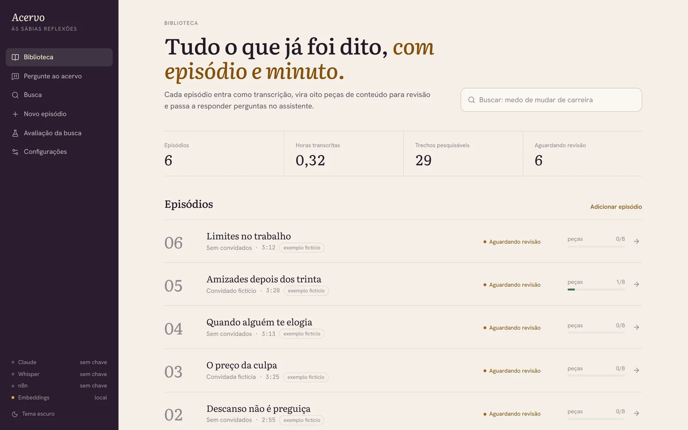
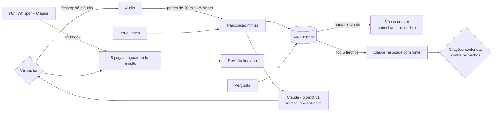
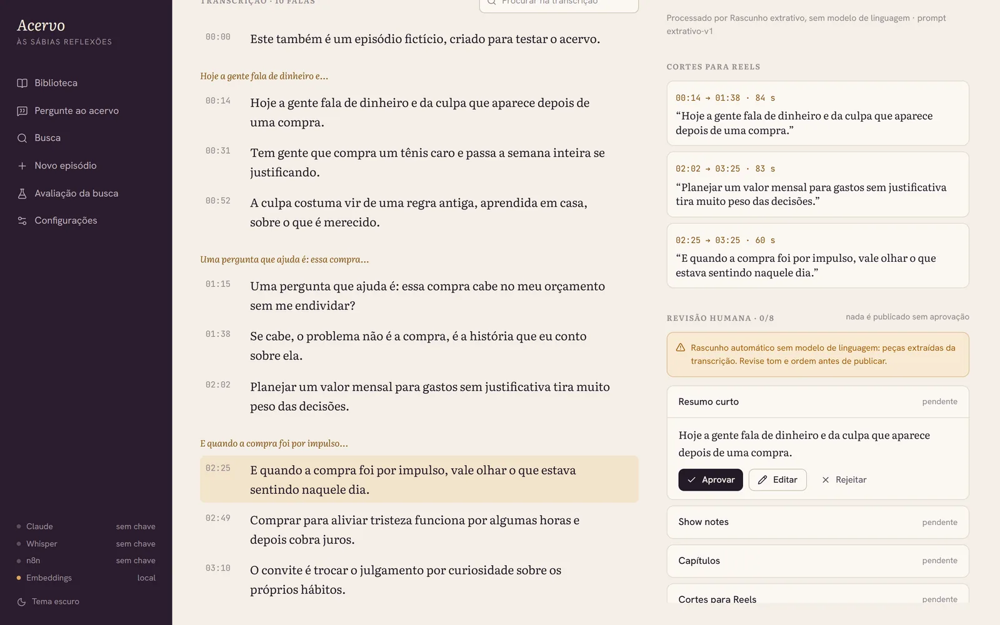
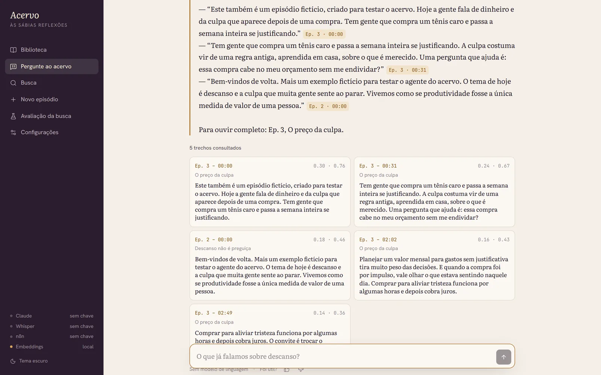
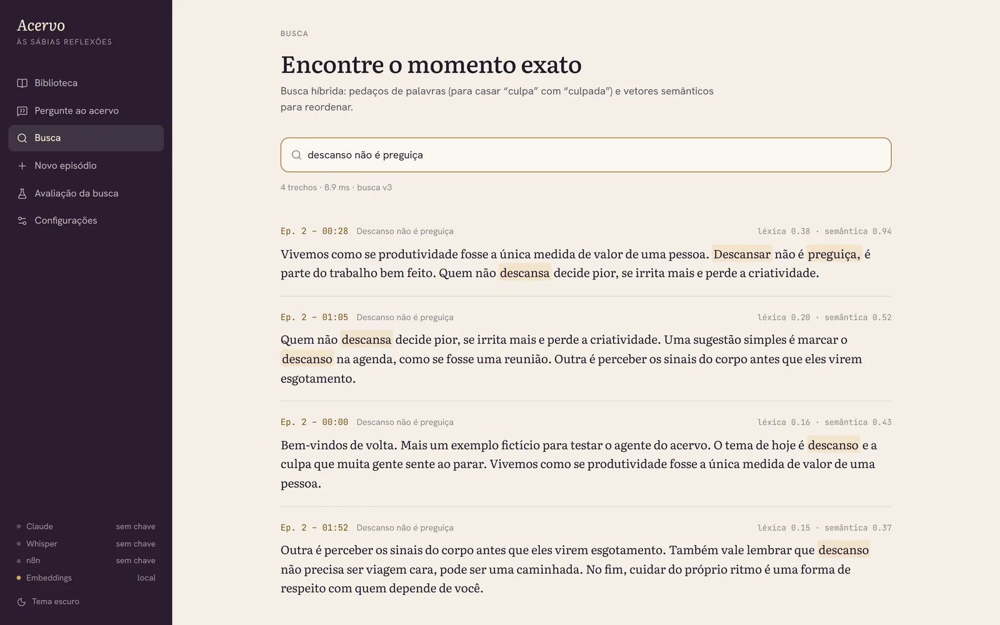
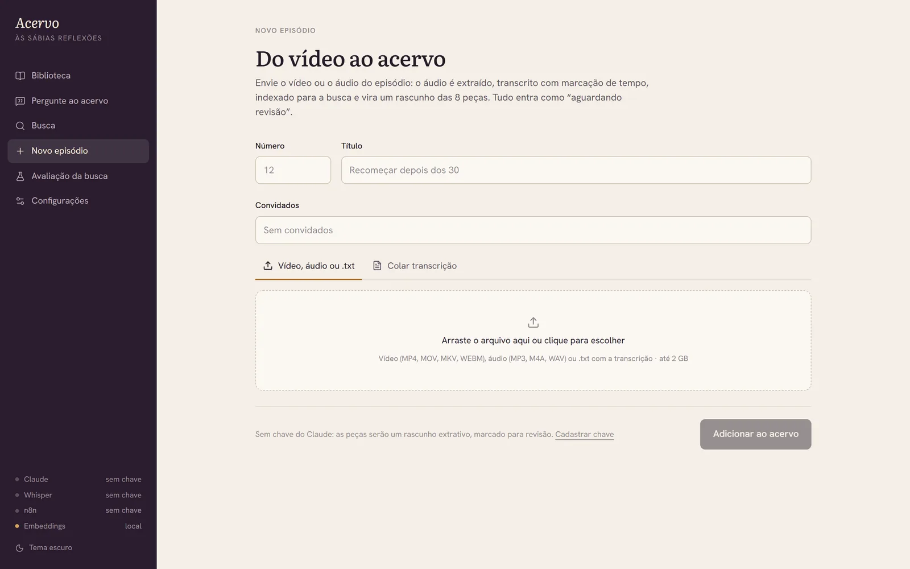
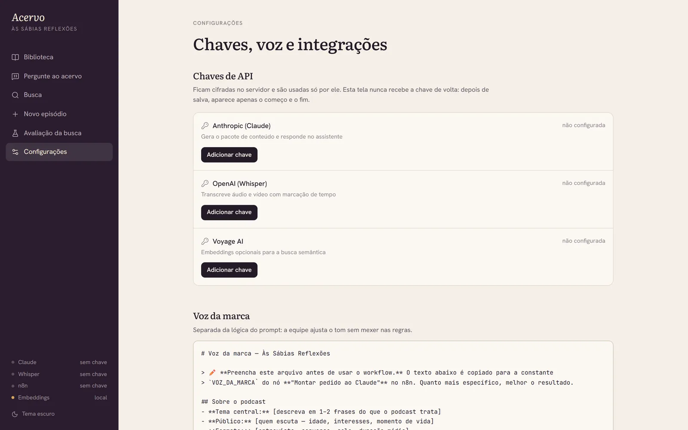
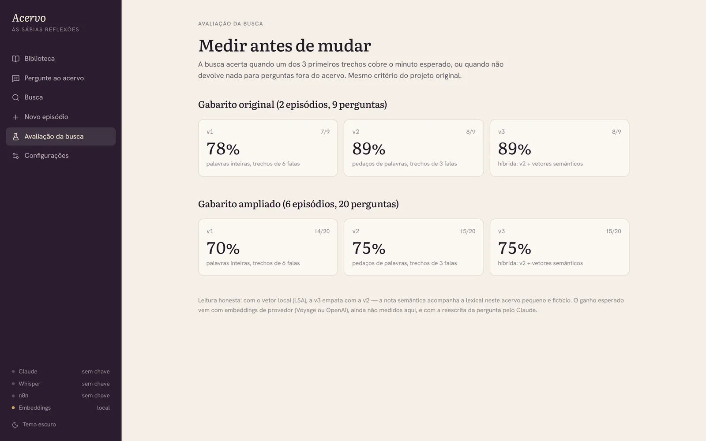

# Às Sábias Reflexões — Acervo com IA

[](https://github.com/Luizamiller/sabias-reflexoes-ia/actions/workflows/testes.yml)

<p>
  <a href="https://luizamiller.github.io/sabias-reflexoes-ia/"></a>
  <a href="#como-rodar"></a>
</p>

**Acesso na demonstração:** Os 6 episódios fictícios passam pelo pipeline completo ao abrir a página; a busca e o assistente respondem com citações.

Plataforma de conhecimento para um podcast: cada episódio entra como vídeo, áudio ou transcrição, vira **oito peças de conteúdo para revisão humana** e passa a responder perguntas num **assistente que cita episódio e minuto** — e que diz "não encontrei" quando o acervo não trata do assunto.

**Autora:** Luiza Miller · Product Owner do Às Sábias Reflexões (dez/2024–ago/2025)
**Stack:** FastAPI · SQLAlchemy · scikit-learn · Claude · Whisper · n8n · React · TypeScript · Tailwind

> As transcrições em `backend/data/transcricoes/` são **exemplos fictícios**, criados para testes. Nenhuma fala real de convidados está no repositório.




## O problema

Como PO do podcast, eu via o trabalho que começava depois de cada gravação: ouvir de novo para escrever descrição, marcar capítulos, achar trechos para Reels, escrever posts e newsletter. Trabalho manual, repetitivo e feito com pressa. E o acervo antigo, cheio de conteúdo bom, ficava esquecido porque ninguém lembrava *em qual episódio* algo tinha sido dito.

## O que a plataforma faz

| Área | O que entrega |
|---|---|
| **Biblioteca** | Episódios com status do pipeline, progresso da revisão e indicadores do acervo |
| **Episódio** | Player de vídeo ou áudio sincronizado com a transcrição (a fala atual acende e a página acompanha), legendas, procurar na transcrição, corrigir uma fala (a busca é reindexada na hora), exportar TXT/SRT/VTT/Markdown, gerar o pacote de novo com o Claude, capítulos, cortes clicáveis e o link `?t=mm:ss` |
| **Revisão** | As 8 peças (resumo, show notes, capítulos, cortes, citações, Instagram, LinkedIn, newsletter) com aprovar, editar ou rejeitar; alertas de validação primeiro |
| **Pergunte ao acervo** | RAG com streaming, citações clicáveis, trechos consultados com as notas da busca e verificação das citações da resposta |
| **Busca** | Busca híbrida com destaque dos termos e notas léxica e semântica |
| **Novo episódio** | Vídeo (MP4, MOV, MKV, WEBM…) ou áudio de até 2 GB com arrastar e soltar, barra de progresso e cancelamento; o áudio é extraído com ffmpeg, cortado em partes de 20 min e transcrito com Whisper (“parte 2 de 5”). Ou transcrição colada / `.txt` |
| **Avaliação** | Taxa de acerto das versões da busca contra os gabaritos, pergunta a pergunta |
| **Configurações** | Chaves de API (Anthropic, OpenAI, Voyage) cadastradas pela tela, testadas no provedor e guardadas cifradas; voz da marca, prompt versionado e integrações |



## Decisões que continuam no centro

O projeto nasceu com regras de produto claras; a reconstrução manteve todas e as levou para o código.

- **Humano no circuito, sempre.** Tudo entra como "aguardando revisão". Um episódio só vira "revisado" quando todas as peças foram aprovadas, editadas ou rejeitadas.
- **Validação contra alucinação.** A validação do workflow n8n foi portada para Python e roda em todo pacote, venha do Claude, do n8n ou do rascunho local: JSON completo, cortes com horário válido e dentro do episódio, citações que existem **literalmente** na transcrição.
- **Citações conferidas também nas respostas.** Cada "(Ep. N – mm:ss)" que o assistente escreve é comparado com as falas dos trechos enviados ao modelo; o que não bate aparece riscado e com aviso.
- **O modelo pode dizer que não sabe.** Se nenhum trecho passa do limiar, a resposta é "não encontrei" e o modelo nem é chamado.
- **Timestamps prontos na entrada.** O modelo copia horários que existem, em vez de calculá-los.
- **Voz da marca separada da lógica** e **prompts versionados** (`prompts/`, com `CHANGELOG.md`); a versão fica gravada em cada pacote.
- **Funciona sem chaves.** Sem Anthropic, as peças são um rascunho extrativo (só frases da transcrição) e o assistente devolve os trechos mais próximos — ambos rotulados como tal.

## Qualidade da busca

Medida com `uv run python -m app.eval` (mesmo critério do projeto original: acerta se um dos 3 primeiros trechos cobre o minuto esperado, ou se não devolve nada para perguntas fora do acervo).

| Versão | O que mudou | Gabarito original (2 ep., 9 perguntas) | Gabarito ampliado (6 ep., 20 perguntas) |
|---|---|---|---|
| v1 | Palavras inteiras, trechos de 6 falas | 78% | 70% |
| v2 | Pedaços de palavras, trechos de 3 falas, limiar 0,12 | **89%** | **75%** |
| v3 | v2 + vetores semânticos (LSA local), fusão por RRF | 89% | 75% |

Os números da v1 e da v2 reproduzem exatamente os do projeto original, e um teste garante que continuem assim.

**Leitura honesta da v3.** Com o vetor local (LSA, sem download nem chave), a nota semântica acompanha a lexical neste acervo pequeno: ela reordena, mas não acrescenta acertos — e, quando usada para ampliar o que conta como relevante, deixava passar perguntas fora do tema. Por isso, com LSA ela só reordena. Com embeddings de provedor (`PROVEDOR_EMBEDDINGS=voyage` ou `openai`) ela também amplia a busca; esse ganho **ainda não foi medido**. Os erros que restam são os mesmos do original: assuntos que aparecem só por exemplos ("me sinto sozinho" quando a fala é "solidão adulta"). A reescrita da pergunta pelo Claude (`REESCREVER_PERGUNTA=1`) continua disponível para esses casos.

## Arquitetura

```
sabias-reflexoes-ia/
├── backend/                     FastAPI · SQLAlchemy 2 · Alembic · SQLite (local) / Postgres (produção)
│   ├── app/
│   │   ├── search/              engine (v1, v2, v3), embeddings (LSA, Voyage, OpenAI), RAG e citações
│   │   ├── pipeline/            transcrição, geração das 8 peças, validação, processamento em segundo plano
│   │   ├── api/                 episódios, revisão, busca, assistente (SSE), avaliação, config, webhook n8n
│   │   └── eval.py              avaliação contra os gabaritos
│   ├── data/                    transcrições fictícias e gabaritos
│   └── tests/                   21 testes (inclui os do agente original)
├── web/                         React 19 · TypeScript · Vite · Tailwind 4 · Radix · Motion · TanStack Query
├── workflows/                   workflow n8n (agora também envia ao acervo)
├── prompts/                     prompt v1 versionado + CHANGELOG
├── config/voz-da-marca.md       tom do podcast (editável também na interface)
└── docs/                        instalação, métricas e arquitetura
```

Decisões técnicas em [`docs/ARQUITETURA.md`](docs/ARQUITETURA.md).

## Telas

**Episódio: transcrição com horários, cortes clicáveis e revisão humana das 8 peças**



**Pergunte ao acervo: resposta com citação de episódio e minuto e os trechos consultados**



**Busca híbrida com destaque dos termos e notas léxica e semântica**



**Novo episódio: vídeo ou áudio de até 2 GB, com progresso do envio**



**Chaves de API cadastradas pela tela, testadas no provedor e guardadas cifradas**



**Avaliação: taxa de acerto de cada versão da busca contra os gabaritos**



## Demonstração online

<https://luizamiller.github.io/sabias-reflexoes-ia/> é um site estático no GitHub Pages, mas a lógica não foi reescrita: **o próprio backend FastAPI roda dentro do navegador**, no [Pyodide](https://pyodide.org) (Python em WebAssembly), num Web Worker. As chamadas a `/api` do frontend são desviadas para ele (`web/src/demo/`).

- Banco SQLite em memória, criado com os dados de exemplo a cada carregamento; recarregar a página volta tudo ao início.
- Sem servidor e sem chaves: upload de áudio e vídeo, transcrição com Whisper e geração com o Claude ficam desativados; as peças são o rascunho extrativo.
- A primeira visita baixa o Python e as bibliotecas (alguns segundos); depois o navegador guarda em cache.
- Gerar de novo: `cd web && pnpm build:demo` (empacota o backend em `public/demo/backend.zip` e faz o build com a base do GitHub Pages).

## Como rodar

Pré-requisitos: Python 3.12 com [uv](https://docs.astral.sh/uv/) e Node 22 com pnpm. Guia completo, inclusive do n8n, em [`docs/como-instalar.md`](docs/como-instalar.md).

```bash
cd backend
uv sync
uv run alembic upgrade head
uv run python -m app.seed               # carrega os 6 episódios fictícios pelo pipeline
uv run uvicorn app.main:app --port 8102
```

```bash
cd web
pnpm install
pnpm dev                                # http://localhost:5102
```

Testes e avaliação:

```bash
cd backend && uv run pytest && uv run python -m app.eval
cd web && pnpm typecheck && pnpm test && pnpm build
cd web && PLAYWRIGHT_CHANNEL=msedge pnpm test:e2e
```

Produção: `docker compose up --build` (Postgres com pgvector disponível; http://localhost:8000). As chaves ficam só no servidor: em `backend/.env` ou cadastradas em Configurações › Chaves de API (veja abaixo).

## Chaves de API e mídia

- **Cadastro pela tela.** Configurações › Chaves de API. Antes de salvar, a chave é conferida com uma chamada gratuita ao provedor (listar modelos); chave recusada não é salva.
- **Cifradas em repouso** (Fernet) na tabela `configuracoes`. A chave-mestra vem de `SEGREDO_MESTRE` ou é gerada em `backend/storage/.chave-mestra` (fora do git). Copiar só o banco não revela as chaves.
- **Nunca voltam para o navegador.** A API devolve só a máscara (`sk-ant…9f2c`) e de onde a chave vem (painel ou ambiente). A chave do painel tem prioridade sobre a do `.env`.
- **Vídeo.** O arquivo vai para o disco em blocos de 1 MB (não passa pela memória) e é servido com `Range`, para o player pular para qualquer minuto. O ffmpeg vem do PATH ou do pacote `imageio-ffmpeg`; a extração gera MP3 mono 16 kHz 48 kbps (~21 MB por hora), cortado em partes de 20 min, abaixo do limite de 25 MB do Whisper. Cada parte recebe como dica o nome do podcast, os convidados e o fim da parte anterior; os horários são somados ao início da parte.
- **Custo.** A tela estima o custo da transcrição pela duração do arquivo (US$ 0,006/min do `whisper-1`); confira a tabela atual da OpenAI.

## Limitações e próximos passos

- **Resultados do uso real ainda a medir** (tempo da equipe por episódio, % de peças aprovadas sem edição, custo por episódio) — método em [`docs/metricas.md`](docs/metricas.md).
- O índice de busca fica em memória e é reconstruído quando o acervo muda; acima de alguns milhares de episódios, mover os vetores para pgvector.
- Sem diarização: as citações não dizem quem falou.
- Sem autenticação: pensado como ferramenta interna da equipe. **Quem acessa a tela pode trocar as chaves e gastar créditos**; expor publicamente exige login, papéis (só administradores mexem nas chaves) e limites de uso.
- A transcrição usa `whisper-1` porque é o modelo da OpenAI que devolve horário por segmento; modelos mais novos de transcrição não devolvem.
- O processamento roda em `BackgroundTasks` do próprio processo; em produção com volume, usar uma fila (RQ, Celery ou Arq).

## Outros projetos

- **UMAMI** — app de delivery com sacola de até quatro lojas, entrega combinada e assistente que monta o pedido. [Demonstração](https://luizamiller.github.io/umami/) · [Código](https://github.com/Luizamiller/umami)
- **Fale com o Farmacêutico** — atendimento farmacêutico no delivery, com IA que sugere e o farmacêutico que decide. [Demonstração](https://luizamiller.github.io/fale-com-farmaceutico/) · [Código](https://github.com/Luizamiller/fale-com-farmaceutico)
- **Panorama Delivery** — análise de 406 mil restaurantes do iFood, transformada em plataforma interativa. [Demonstração](https://luizamiller.github.io/analise-restaurantes-ifood/) · [Código](https://github.com/Luizamiller/analise-restaurantes-ifood)

---

[LinkedIn](https://www.linkedin.com/in/luiza-miller)
